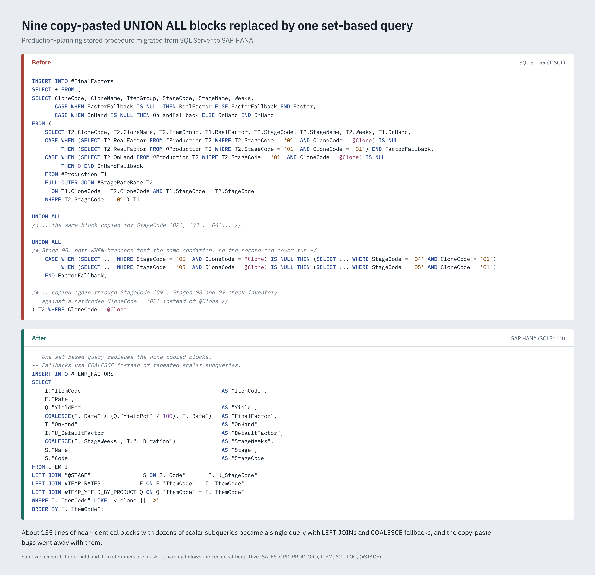

<h1 align="center">Production Planning Engine — SQL&nbsp;Server&nbsp;→&nbsp;SAP&nbsp;HANA</h1>

<p align="center">
  <strong>Re-engineering a business-critical production-planning stored procedure</strong><br>
  from a 900-line SQL Server monolith into a native, null-safe, configuration-driven SAP HANA solution.
</p>

<p align="center">
  
  
  
  
</p>

<p align="center">
  
  
  
  
</p>

---

> **TL;DR** — A production planning procedure that decides *how many units are needed at each stage of production* to meet upcoming sales demand had to move from SQL Server to SAP HANA. A one-to-one port was impossible, so I rebuilt it: **~135 lines of copy-paste collapsed into a single expression, 14 temporary tables became 6, every division was made safe, and hardcoded business rules were moved into configuration** — with identical results.

## Highlights

| Metric | Before (SQL Server) | After (SAP HANA) |
|---|---|---|
| Lines of code | ~900 | ~700 |
| Temporary tables | 14 | **6** |
| Duplicated stage blocks | 9 | **1** |
| Division safety | raw `a / b` | `a / NULLIF(b,0)` + `COALESCE` |
| Stage durations | hardcoded day ranges | **data-driven config table** |
| Parameterization | literal per-clone branches | **single dynamic parameter** |
| Business results | — | **preserved 1:1** |

## Overview

The source is a production indicator that answers one operational question:

> *How many units are needed at each production stage right now to satisfy the coming weeks of sales?*

It works **backwards through a chain of production stages** (`M0 → M1 → … → Nursery`) and weights every stage by two factors — its **productivity (rate)** and its **quality** — under one governing identity:

```
real factor = quality × rate
```

The original logic lived in a single, heavily-nested SQL Server stored procedure. Moving it to SAP HANA was not a copy-paste job: T-SQL and SQLScript differ in syntax, built-in functions, typing and temp-table handling. The migration therefore became a **structured re-engineering**, carried out with the **PACE** method (Plan · Analyze · Construct · Evaluate).

## What this project demonstrates

- **Cross-platform SQL fluency** — real, non-trivial translation between **T-SQL** and **SAP HANA SQLScript**.
- **Refactoring judgment** — recognizing and removing anti-patterns (mass duplication, dead complexity, magic numbers) instead of carrying them across.
- **Defensive engineering** — eliminating divide-by-zero and `NULL` propagation across a chained calculation.
- **Data modeling sense** — externalizing business rules (stage durations) into configuration so analysts can tune them without touching code.
- **Communication** — documenting the work clearly for both technical and non-technical audiences (see [Documentation](#documentation)).

## The challenge

The legacy procedure was a classic monolith:

- ~900 lines in a single procedure, with **14 temporary tables**.
- A safety-stock backup value computed through **deeply nested `IIF` statements inside scalar subqueries**.
- The rule *"use this clone's factor, else fall back to the default clone"* **copy-pasted as nine near-identical `UNION ALL` blocks** (~15 lines each).
- **Raw divisions everywhere** in the backward stage chain — one zero or missing value could break the whole run.
- **Stage lengths hardcoded** as per-product day ranges scattered throughout the query.
- **Latent copy-paste bugs**: in one stage block both `WHEN` branches tested the same condition, so the second could never run; in two others, inventory was checked against a hardcoded clone instead of the input parameter.
- Reliance on SQL Server-only constructs: `IIF`, `DATEADD` / `GETDATE` / `DATEPART`, inline `DECLARE @x = (SELECT …)`, `#temp` tables, `COLLATE`, and implicit type coercion.

## Approach — the PACE method

| Phase | What happened |
|---|---|
| **Plan** | Inventoried the legacy asset and locked down the business rules that had to be preserved exactly (safety-stock percentages, the stage chain, `factor = quality × rate`). |
| **Analyze** | Catalogued every T-SQL ↔ SQLScript incompatibility and separated the *fragile* (divisions, duplication, hardcoding) from the *broken* (dialect gaps). |
| **Construct** | Rebuilt natively in SQLScript — deduplicated, consolidated, made null-safe, and driven by SAP master data. |
| **Evaluate** | Validated output parity against the original and quantified the structural gains. |

**Full write-up →** [PACE Method report](./docs/PACE_Method_SQLServer_to_SAP_HANA.pdf)

## Before → After

> All snippets are **sanitized** — table names, custom fields and business constants are replaced with generic placeholders. The transformation patterns are faithful; only identifying values are masked.

**1 · Division safety across the stage chain** — every denominator guarded, missing factors recovered, the result defaulted:

```sql
-- BEFORE (T-SQL): raw division, NULL-prone
DECLARE @INV FLOAT =
 (SELECT ((@VIV / weeks) * dur) / factor
  FROM #Factores WHERE Stage = 8);

-- AFTER (SQLScript): safe by construction
SELECT IFNULL(
  ((:v_VIV / NULLIF(F9."Dur",0)) * F8."Dur")
  / NULLIF(COALESCE(F8."Fac", F8."FacRate"), 0),
  0)
INTO v_INV
FROM #Factores F8
LEFT JOIN #Factores F9 ON F9."Stage" = '09'
WHERE F8."Stage" = '08';
```

**2 · Killing the duplication** — nine near-identical fallback blocks (~135 lines) become one expression, applied to every stage at once:

```sql
-- BEFORE (T-SQL): repeated for stages 01…09  (× 9 blocks)
SELECT …,
  CASE WHEN (SELECT Fac … WHERE Stage='0X' AND Clone=@CLON) IS NULL
       THEN (SELECT Fac … WHERE Stage='0X' AND Clone='01') END
FROM #P2 FULL JOIN #Base …
WHERE Stage='0X'
UNION ALL …   -- (×9)

-- AFTER (SQLScript): once, for all stages
COALESCE(clone_factor, default_factor) AS "FactorFinal"
```

**Six more transformations →** dates, variable loading, strict typing, hardcoded windows and parameterization are in the [Technical Deep-Dive](./docs/PACE_Technical_Deep_Dive_SQLServer_to_SAP_HANA.pdf).

### Visual walkthrough

Four longer side-by-side excerpts, taken from the real procedure and sanitized. The same code is available as text in [`src/`](./src).

<p align="center">
  
</p>

| | Transformation | What it shows |
|---|---|---|
| 1 | [Hardcoded date windows → configured stage durations](./docs/images/01_stage_windows.png) | Nine hand-tuned day ranges replaced by one rule driven by a duration table with monthly overrides. |
| 2 | [Nine `UNION ALL` blocks → one set-based query](./docs/images/02_duplicated_blocks.png) | The copy-paste fallback logic collapsed into `LEFT JOIN` + `COALESCE`, including the two latent bugs it carried. |
| 3 | [Unprotected cascade → NULL-safe, division-safe](./docs/images/03_safe_division.png) | `NULLIF`, `COALESCE` and `IFNULL` guarding every step of the backward stage chain and the yield calculation. |
| 4 | [Hardcoded clone branches → one parameter](./docs/images/04_parameterized_clones.png) | Per-clone `IIF` branches (with inconsistent `NULL` handling) replaced by a single parameterized query. |

## Migration decisions at a glance

| Concern | SQL Server (before) | SAP HANA (after) |
|---|---|---|
| Conditional | `IIF(cond, a, b)` | `CASE WHEN cond THEN a ELSE b END` |
| Dates | `DATEADD(WW,-52,GETDATE())` | `ADD_DAYS(CURRENT_DATE, -364)` |
| Variable load | `DECLARE @x = (SELECT …)` | `SELECT … INTO v_x FROM …` |
| Temp storage | `CREATE TABLE #t` — 14 of them | `LOCAL TEMPORARY TABLE` — 6 |
| Stage fallback | 9 × `UNION ALL` blocks | `COALESCE(clone, default)` |
| Durations | hardcoded `-84 / -112 / -56` days | config table → `weeks × 7` |
| Division safety | `a / b` | `a / NULLIF(b,0)` + `IFNULL / COALESCE` |
| Typing | implicit coercion | `TO_DECIMAL / TO_INT / TO_NVARCHAR` |

## Results

- **Output parity** — the same staged report (minimum and differentiation units per stage, plus programmed vs. projected production by week, month and year).
- **Simpler** — ~900 → ~700 lines, 14 → 6 temporary tables, 9 → 1 fallback expression.
- **More robust** — no divide-by-zero or `NULL` failures; safe by construction.
- **Cleaner logic** — two latent copy-paste bugs removed along the way.
- **More maintainable** — stage durations and factors are now **configuration, not code**; the business retunes SAP tables instead of editing the procedure.

## Tech stack

- **Databases:** Microsoft SQL Server (source), SAP HANA (target)
- **Languages:** T-SQL, SAP HANA SQLScript
- **Techniques:** stored-procedure re-engineering, query optimization, null-safe arithmetic, configuration-driven design, ERP master-data integration
- **Method:** PACE (Plan · Analyze · Construct · Evaluate)

## Repository structure

```text
production-planning-hana-migration/
├── README.md
├── docs/
│   ├── PACE_Method_SQLServer_to_SAP_HANA.pdf                # methodology write-up
│   ├── PACE_Technical_Deep_Dive_SQLServer_to_SAP_HANA.pdf   # code deep-dive
│   └── images/                                              # before/after comparisons
│       ├── 01_stage_windows.png
│       ├── 02_duplicated_blocks.png
│       ├── 03_safe_division.png
│       └── 04_parameterized_clones.png
└── src/
    ├── before_sqlserver_sanitized.sql   # legacy T-SQL excerpts
    └── after_hana_sanitized.sql         # rebuilt SQLScript excerpts
```

> The `src/` files are **sanitized excerpts** kept for illustration. The full production procedure is client-confidential and is intentionally not published here.

## Documentation

| Document | What's inside |
|---|---|
| [**PACE Method**](./docs/PACE_Method_SQLServer_to_SAP_HANA.pdf) | The end-to-end methodology and the business context, for any audience. |
| [**Technical Deep-Dive**](./docs/PACE_Technical_Deep_Dive_SQLServer_to_SAP_HANA.pdf) | Seven side-by-side before/after query transformations, for engineers. |
| [**Source excerpts**](./src) | Longer sanitized T-SQL and SQLScript excerpts for four of the transformations, as plain `.sql`. |

## A note on confidentiality

This project is based on real client work. To respect that, **all published material is sanitized**: table names, custom field names, item-code conventions and business constants are replaced with generic placeholders throughout the documents and code samples. The engineering — the patterns, decisions and techniques — is shown in full; the underlying data model is not.

## About

**Author:** Raúl Eduardo García Cuéllar · *SQL / Data Engineering*

- **LinkedIn** — [raúl-eduardo-garcía-cuéllar](https://www.linkedin.com/in/raúl-eduardo-garcía-cuéllar-5843bb40a)
- **GitHub** — [github.com/Edugar97](https://github.com/Edugar97)
- **Email** — [raulcuellar.rc97@gmail.com](mailto:raulcuellar.rc97@gmail.com)

<p align="center"><sub>Built to show the work behind a real SQL Server → SAP HANA migration — clearly, and without exposing client data.</sub></p>